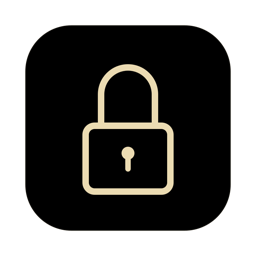

# lockr



> i3lock-style lock screen for macOS that keeps your Mac awake.

Black screen on every display, input blocked, nothing goes to sleep. Builds,
downloads and jobs keep running while you're away. Unlock with Touch ID or your
password.


#### **Requires:** macOS 14+

## Install

```bash
brew install --cask merlinkraemer/tap/lockr
```

Or grab the zip from [Releases](https://github.com/merlinkraemer/lockr/releases).

Open Lockr once and allow **Accessibility** when asked (needed to block input).
From then on it runs in the background and starts at login.

## Keys

| Key | Action |
|-----|--------|
| `Cmd`+`Shift`+`/` | Lock |
| Touch ID | Unlock |
| password + `Enter` | Unlock |

## Config

```bash
lockr --shortcut ctrl-opt-l   # change shortcut
lockr --shortcut              # show current
lockr --shortcut default      # back to cmd-shift-slash
lockr --shortcut none         # off, e.g. to bind `open -a Lockr` in AeroSpace/skhd
lockr --disable               # stop + don't start at login
lockr --enable                # turn back on
```

Shortcut = modifiers (`cmd`, `shift`, `opt`, `ctrl`) + one key (`a`–`z`,
`0`–`9`, `f1`–`f12`, `slash`, `comma`, `period`, `space`, …), joined by `-`.
`lockr --help` lists all keys.

### Stay awake with the lid closed

macOS sleeps on lid close no matter what `caffeinate` says. Allow Lockr to toggle
`pmset disablesleep` while locked:

```bash
echo "$USER ALL=(root) NOPASSWD: /usr/bin/pmset disablesleep 1, /usr/bin/pmset disablesleep 0" | sudo tee /etc/sudoers.d/lockr
```

Remove with `sudo rm /etc/sudoers.d/lockr`. A closed laptop in a bag that stays
awake gets hot.

## Uninstall

```bash
lockr --disable && brew uninstall --cask lockr
```

## Build from source

```bash
git clone https://github.com/merlinkraemer/lockr && cd lockr
make install                                      # → ~/Applications/Lockr.app
LOCKR_TEST_SECONDS=20 build/Lockr.app/Contents/MacOS/Lockr   # test lock, auto-unlocks
```

Ad-hoc builds need Accessibility re-granted after every rebuild; pass
`CODESIGN_IDENTITY="Apple Development: …"` to keep it. Look and feel live at the
top of `Sources/LockSession.swift`. Releases: `scripts/release.sh`. README images: `scripts/make-screenshot.sh`, `swift scripts/make-icon.swift`.

## Notes

- Not a security boundary like the login window: it stops casual access, not a
  determined person with the machine (e.g. holding the power button).
- Displays plugged in after locking aren't covered.

MIT
